<div align="center">

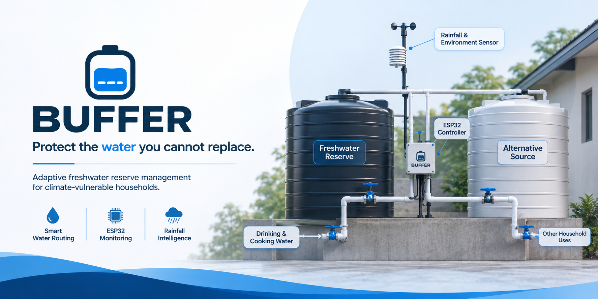

# BUFFER

### Protect the water you cannot replace.

**An adaptive freshwater reserve management and intelligent water-routing system that helps climate-vulnerable households secure their drinking water supply until the next rainfall.**

Xylem Global Student Innovation Challenge 2026 · University track · Water Access

[](https://ashfaqstu.github.io/BUFFER/)
[](https://youtu.be/FR0yXH66FLY)
[](#the-problem)
[](LICENSE)

</div>

---

## The problem

*Picture late April in Koyra, on the southwest coast of Bangladesh.* The pond is too salty to drink, and so is the ground
water. The only safe water a family has is last monsoon's rain in one tank, and since November that tank has served
everything: drinking, cooking, the toilet, the floor. Now it is almost empty, and the next reliable rain is weeks
away. Nobody could tell this family in January that the water used to clean the floor was the water their children
would need in May.

| | |
|---|---|
| **27%** | of Koyra households keep rainwater all year, although 100% drink it in the monsoon ([Cleaner Water, 2025](https://doi.org/10.1016/j.clwat.2025.100171)) |
| **91%** | of households cannot store enough rainwater for the year; stored rain lasts 4.7 months on average ([Prothom Alo, 2026](https://en.prothomalo.com/bangladesh/cxtwlpjmo7)) |
| **4.65 months** | a year without reliable water across five coastal sub-districts, 2.84 in Koyra ([UNDP survey of 66,234 households](https://www.adaptation-undp.org/water-crisis-southwest-bangladesh-paani-apa-rescue)) |
| **73%** | of people in five coastal sub-districts drink saline water above the safe limit (UNDP survey of 271,464 people, [UNDP, 2022](https://www.adaptation-undp.org/water-crisis-southwest-bangladesh-paani-apa-rescue)) |
| **35 million+** | people in coastal Bangladesh affected by freshwater salinisation ([BRAC BIGD](https://bigd.bracu.ac.bd/study/enhancing-safe-drinking-water-security-and-climate-resilience-through-rainwater-harvesting/)) |

### Voices from the coast

> **"Ask for rice and we would give you rice. But water, we cannot give."**
> A resident of Paikgacha, Khulna, speaking to Jamuna TV, 12 May 2026

> *"I had to spend two hours each day collecting water."*
> Lalita Roy, Bajua Union, Dakope, Khulna, before her family received a rainwater tank ([UNDP, 2022](https://www.adaptation-undp.org/women-advocates-harvesting-rainwater-salinity-affected-coastal-bangladesh))

- **Tanks alone are not the whole answer.** Raushan Ara Akhter, a "Paani Apa" who installs and maintains rainwater
  tanks for 88 families in Dakope, says the hardest part for many families is managing their systems day to day
  ([UNDP, 2022](https://www.adaptation-undp.org/water-crisis-southwest-bangladesh-paani-apa-rescue)).
- **Families already try to save.** Households in Dakope describe conserving rainwater during the monsoon so it lasts
  the rest of the year. What they lack is a way to know how much to save, and when.

The water is already in the tank. What is missing is a way to make it last.

## What BUFFER does

BUFFER is a small controller that fits onto the rainwater tank a family already has. It manages stored rain the way a
phone manages its battery: it knows how many **days** of drinking water are left, compares that with the wait for the
next reliable rain, and routes flexible uses to a second source **before** the drinking reserve is at risk.

| 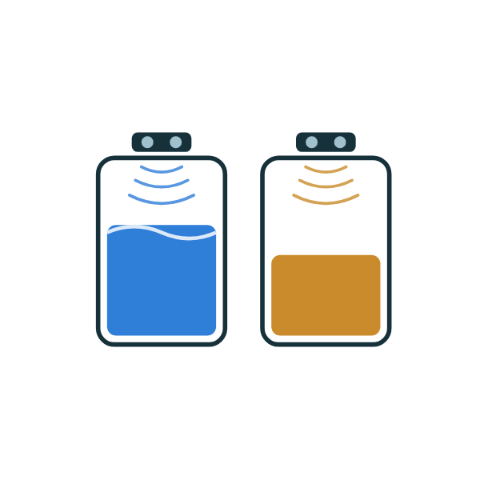<br>**1. Measure** | 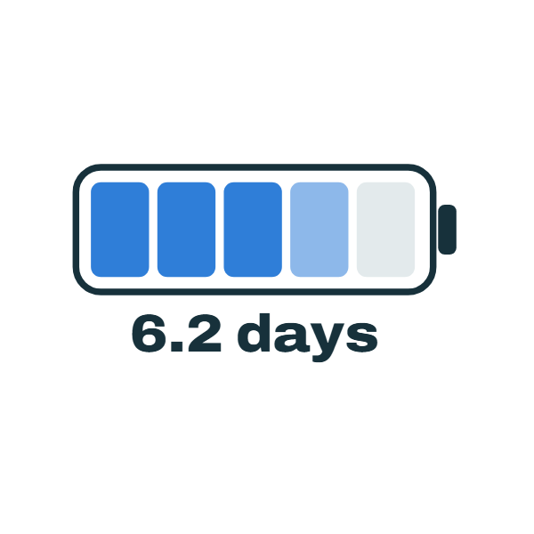<br>**2. Count the days** | 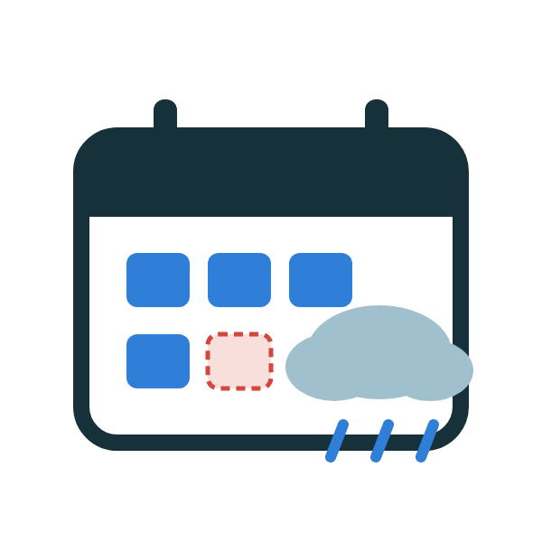<br>**3. Look ahead** | 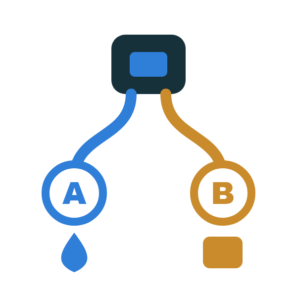<br>**4. Route** |
|:---:|:---:|:---:|:---:|
| Ultrasonic sensors read both tanks; a flow meter counts every litre | Litres become a freshwater runway in days of drinking water | The runway is compared with the wait for reliable rain, from 34 seasons of records | Valves move flexible uses to the second source until the reserve is safe |

- **Drinking and cooking always come first.** Only the toilet, floor cleaning and selected washing move.
- **It saves only when it must,** and tightens the plan if the rain is late.
- **The family stays in charge** with a manual override.
- **It runs on its own:** no internet, no cloud, no new water source and no chemicals.

<p align="center">
  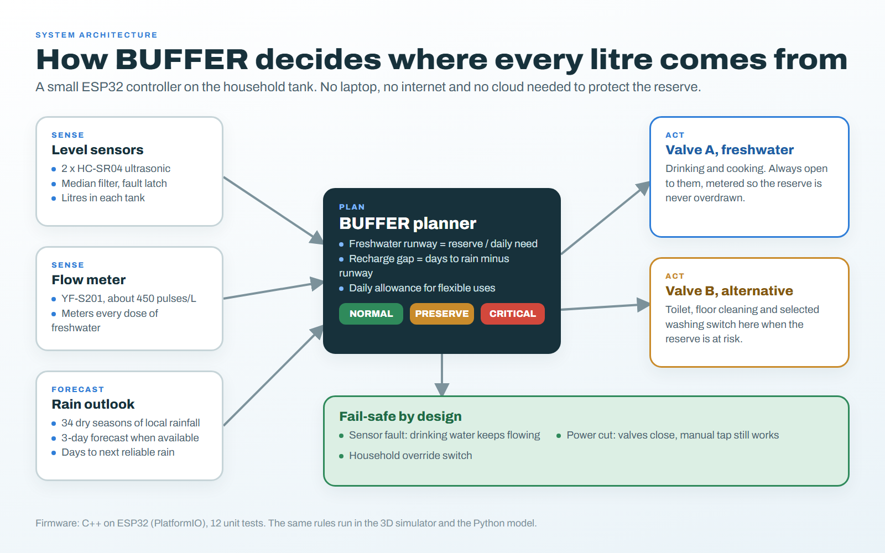
</p>

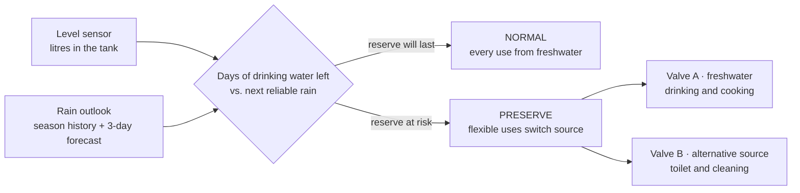

## Built and tested

Our physical prototype: two tanks, two valves and an ESP32 running the BUFFER firmware on its own, with no laptop or
internet. We built it and tested it on the bench with real water.

| Bench prototype | Controller |
|---|---|
|  |  |

| Part | Role |
|---|---|
| ESP32 DevKit V1 | Sensing, planning, valve control, USB telemetry |
| 2 × HC-SR04 ultrasonic sensors | Level in each tank (median filter, fault latch) |
| 2 × 12 V normally-closed solenoid valves + relay module | Valve A (freshwater), valve B (alternative); closed without power |
| YF-S201 flow sensor | Metered dose and actual freshwater use |
| 12 V adapter + LM2596 buck converter | Power for valves and electronics |

Bench prototype: **about US$48**, priced part by part in [hardware/bom.csv](hardware/bom.csv). Household version:
**about US$52**, designed to fit the tanks non-profit organizations already install
([hardware/installation.md](hardware/installation.md)).

## The live simulator

**[Open the live simulator](https://ashfaqstu.github.io/BUFFER/)** A 3D digital twin of a BUFFER household that
runs the same planning and routing rules as the controller firmware.

<p align="center">
  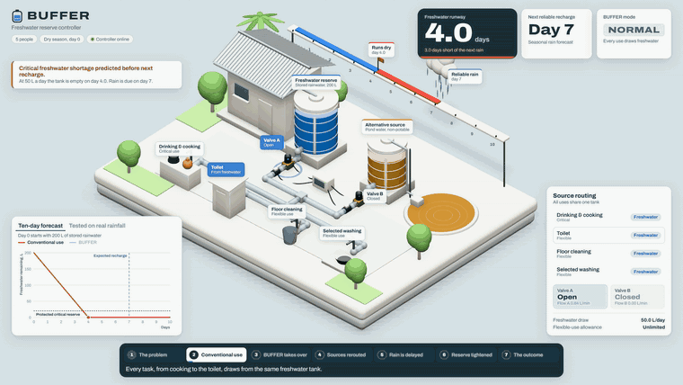
</p>

| Guided demo: conventional use runs dry on day 4 | Guided demo: BUFFER reroutes and holds to day 7 |
|---|---|
| 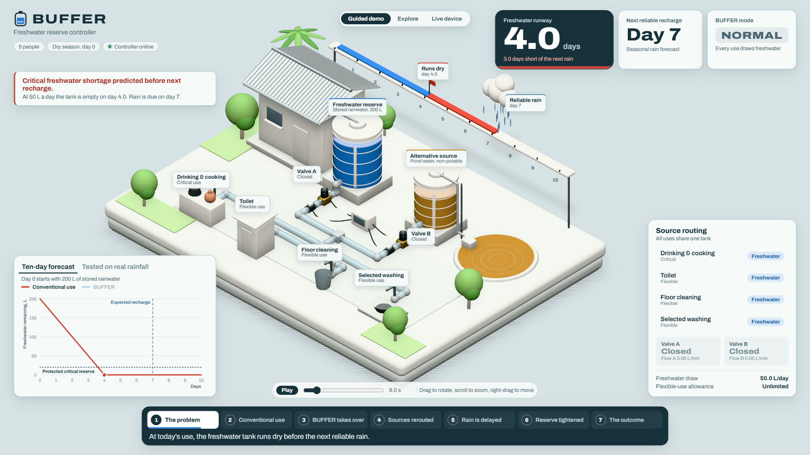 |  |
| **Explore: run the model on your own household** | **Live device: mirror the real controller over USB** |
| 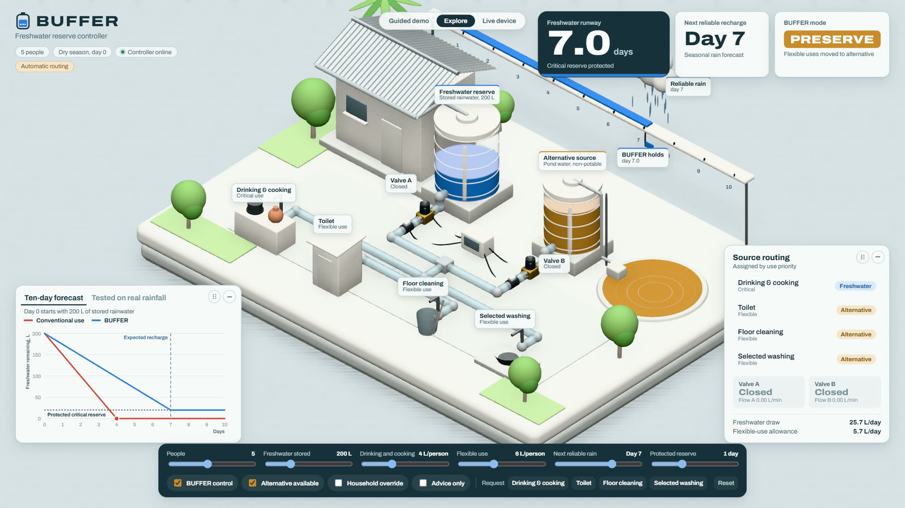 |  |

- **Guided demo:** a 45-second story. Conventional use runs dry on day 4.0; BUFFER switches to Preserve and holds to
  day 7.0, then to day 9.0 when the rain is delayed.
- **Explore:** set people, stored litres, demand, protected reserve, next reliable rain, alternative source, household
  override and advice-only mode, and watch the plan change.
- **Live device:** connects to the ESP32 over Web Serial (Chrome or Edge) and mirrors its tanks, valves and decisions.

## Results

Tested on **34 real dry seasons of rainfall from Koyra** (NASA POWER, 1991-2025) for a 5-person household with a
3,000 L tank, with a daily water-balance model that runs the same decision rule as the firmware.

<p align="center">
  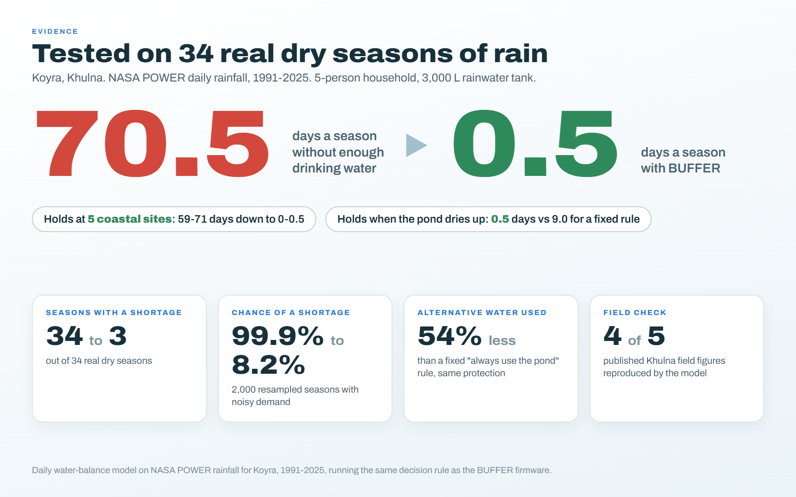
</p>

| | Without BUFFER | With BUFFER |
|---|:---:|:---:|
| Days without enough drinking water, per season | **70.5** | **0.5** |
| Seasons with any shortage | 34 of 34 | 3 of 34 |
| Worst season | 114 days | 9 days |
| Chance of a shortage (2,000 resampled seasons, noisy demand) | 99.9% | 8.2% |

- Same protection as always using the alternative source, with **54% less** alternative water.
- Holds when the pond dries up from March to May: **0.5** shortage days against 9.0 for a fixed rule.
- Holds at five Bangladeshi coastal sites (59-71 shortage days down to 0-0.5).
- Survives a month-long level-sensor outage every season and still averages 0.5 days.
- Run the way households behave today, the model reproduces four of five published field figures from Khulna.

<p align="center">
  
</p>

Full method and every experiment: [simulation/results/REPORT.md](simulation/results/REPORT.md) · impact write-up: [docs/IMPACT.md](docs/IMPACT.md)

## Why BUFFER stands out

<p align="center">
  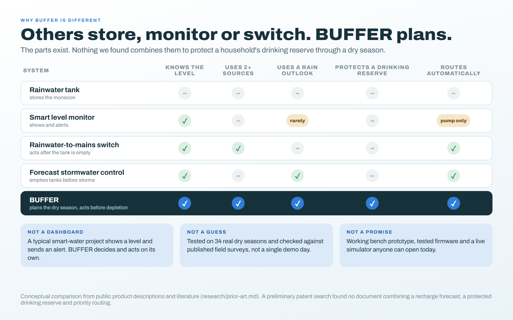
</p>

- **It decides, not just displays.** Level monitors show a number and send an alert. BUFFER plans the whole season and
  drives the valves itself.
- **It acts before the tank runs dry.** Rainwater-to-mains switches act only once the tank is empty and assume a mains
  supply these villages do not have.
- **It holds water, not drains it.** Forecast-controlled stormwater systems empty tanks before storms; BUFFER uses the
  forecast to keep water through a dry spell.
- **Drought hedging for one household.** Reservoir operators ration early to avoid severe shortages later; BUFFER brings
  that idea to a single family's tank with several sources and fixed use priorities.

## Ready for the real world

| Version | What it does | Estimated unit cost |
|---|---|---|
| **BUFFER Lite** | Level sensor, controller and lights; advises which source to use | about US$21 |
| **BUFFER Control** | Adds valves and a flow meter; routes automatically | about US$52 (US$77-85 with solar) |
| **BUFFER Community** | Control on a shared tank, with a programme dashboard for NGOs | per site |

### Who it is for, who pays and who maintains it

- **Who it is for.** Households that already own a rainwater tank and a second, non-drinking source such as a pond or
  second tank. UNDP's coastal adaptation programme alone has installed 2,000 L tanks at about **13,300 households**
  across 39 unions in Khulna and Satkhira
  ([UNDP, 2022](https://www.adaptation-undp.org/women-advocates-harvesting-rainwater-salinity-affected-coastal-bangladesh)).
- **Who pays.** The NGO and donor programmes that already fund household tanks add BUFFER Control to each
  installation, at about US$52 per home: roughly **US$0.75 per drinking-water shortage day avoided** in the first
  season, and less every season after. Families pay nothing up front.
- **Who maintains it.** Local tank caretakers already exist. UNDP's "Paani Apa" women each serve dozens of households
  for about Tk 20 (US$0.17) per household a month, and BUFFER's quarterly sensor and valve checks fit into the same
  rounds.

### Safe when things go wrong

- **Power cut:** both valves close and the manual tap still works.
- **Sensor fault:** drinking water keeps flowing and the reserve is protected by default.
- **Water quality:** before installation, the NGO partner and local health guidance qualify the second source for
  specific uses only: the toilet, floor cleaning and washing that never touches food or the body. Drinking and
  cooking are hard-wired to freshwater and can never be re-routed.

### Impact at scale

- **Per household:** about 70 shortage days avoided every dry season.
- **The 13,300 UNDP tank households:** about 930,000 household shortage days avoided a season.

## What's next

1. **Production-ready BUFFER units:** a sealed, weatherproof controller with a custom circuit board, solar power and
   plug-in valve kits that local technicians can fit to existing tanks.
2. **Partnerships with NGOs:** start with the programmes that already put tanks in homes, such as UNDP's
   Gender-responsive Coastal Adaptation project and WaterAid Bangladesh, building on their tanks, trained "Paani Apa"
   caretakers and community trust.
3. **Pilot testing in real homes:** 10-20 households for one dry season, then a controlled pilot in Koyra or
   Paikgachha ([docs/PILOT_PLAN.md](docs/PILOT_PLAN.md)).
4. **Awareness campaigns** in climate-vulnerable communities on counting drinking water in days and saving early.
5. **Scale through programmes** to 100-1,000 households, and then to other salinity-affected coasts.

We want BUFFER to keep protecting families long after the competition ends.

## Built with

| Part | Technology |
|---|---|
| Simulation | Python 3.12, NumPy, pandas, Matplotlib, pytest; NASA POWER daily rainfall (PRECTOTCORR) |
| Firmware | C++ on the Arduino framework for ESP32, PlatformIO, Unity tests |
| Simulator | React 19, TypeScript, Vite, three.js with React Three Fiber, drei and postprocessing, Web Serial API |
| Quality | pytest and Unity test suites, GitHub Actions workflows (tests, firmware build, simulator deploy), oxlint, Playwright browser checks |

## Repository

```
BUFFER/
├── simulation/   daily water-balance model, 5 policies, sweeps, Monte Carlo, results and figures
├── firmware/     ESP32 controller: sensing, planning, routing, fail-safes, telemetry, unit tests
├── dashboard/    3D simulator: guided demo, Explore, Live device (deployed to GitHub Pages)
├── hardware/     bill of materials, wiring and pin map, serial protocol, household installation
├── validation/   bench test protocol with pass criteria
├── research/     bibliography, prior art, patent search, media sources
├── docs/         impact, failure modes, deployment and business model, pilot plan
└── PROJECT.md    full project brief: problem, research basis, design decisions
```

## Run it yourself

```bash
# simulation (Python 3.12)
cd simulation
pip install -r requirements.txt
python -m pytest                                          # 10 tests
python -m buffer_sim.experiments && python -m buffer_sim.report

# simulator (Node.js 20.19+ or 22.12+)
cd dashboard
npm install
npm run dev                                               # http://localhost:5173

# firmware (PlatformIO)
cd firmware
pio test -e native                                        # 12 controller logic tests
pio run -e esp32dev -t upload                             # flash the ESP32
```

## Team

| | |
|---|---|
| **Ahammad Shawki** | Bangladesh University of Engineering and Technology |
| **Mohammad Ashfaqul Hasan** | Bangladesh University of Engineering and Technology |
| **Nourin Richi** | BRAC University |

## Sources and acknowledgements

Key sources (full list in [research/bibliography.md](research/bibliography.md)):

- *Drinking water management: Challenges and adaptive strategies in salinization-affected coastal communities of Bangladesh*, Cleaner Water, 2025. [doi:10.1016/j.clwat.2025.100171](https://doi.org/10.1016/j.clwat.2025.100171)
- UNDP Gender-responsive Coastal Adaptation, *Water crisis in the Southwest of Bangladesh: "Paani Apa" to the rescue*. [adaptation-undp.org](https://www.adaptation-undp.org/water-crisis-southwest-bangladesh-paani-apa-rescue)
- Ghosh, S. and Ahmed, T. (2022), *Assessment of Household Rainwater Harvesting Systems in the Southwestern Coastal Region of Bangladesh*, Water 14(21), 3462. [doi:10.3390/w14213462](https://www.mdpi.com/2073-4441/14/21/3462)
- BRAC Institute of Governance and Development, *Enhancing Safe Drinking Water Security and Climate Resilience Through Rainwater Harvesting*. [bigd.bracu.ac.bd](https://bigd.bracu.ac.bd/study/enhancing-safe-drinking-water-security-and-climate-resilience-through-rainwater-harvesting/)
- Saha, A. et al. (2024), *Decision support system for community managed rainwater harvesting*, Heliyon 10(9), e30455.
- Shih, J.-S. and ReVelle, C. (1995), *Water supply operations during drought: A discrete hedging rule*, European Journal of Operational Research 82(1), 163-175.
- UNDP Climate Change Adaptation (2022), *Women advocates for harvesting rainwater in salinity-affected coastal Bangladesh*. [adaptation-undp.org](https://www.adaptation-undp.org/women-advocates-harvesting-rainwater-salinity-affected-coastal-bangladesh)
- Jamuna TV news report from Paikgacha, Khulna, 12 May 2026, interview with a local resident on the drinking-water crisis.
- Rainfall data: [NASA Langley Research Center POWER Project](https://power.larc.nasa.gov/), daily corrected precipitation for Koyra, 1991-2025.

## License

[MIT](LICENSE)
