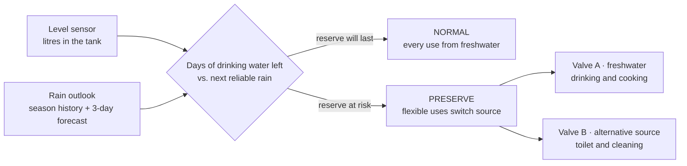
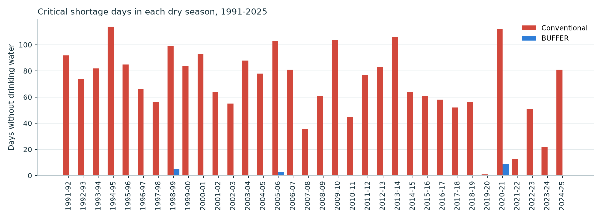
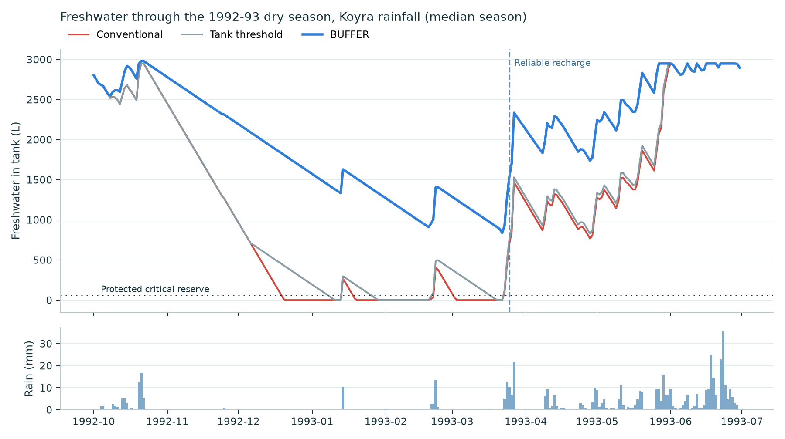
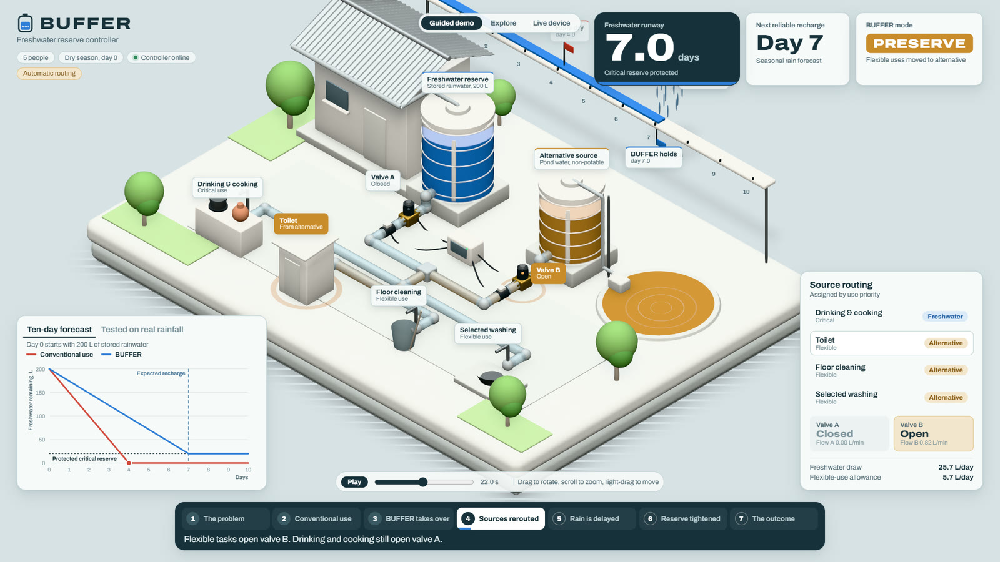
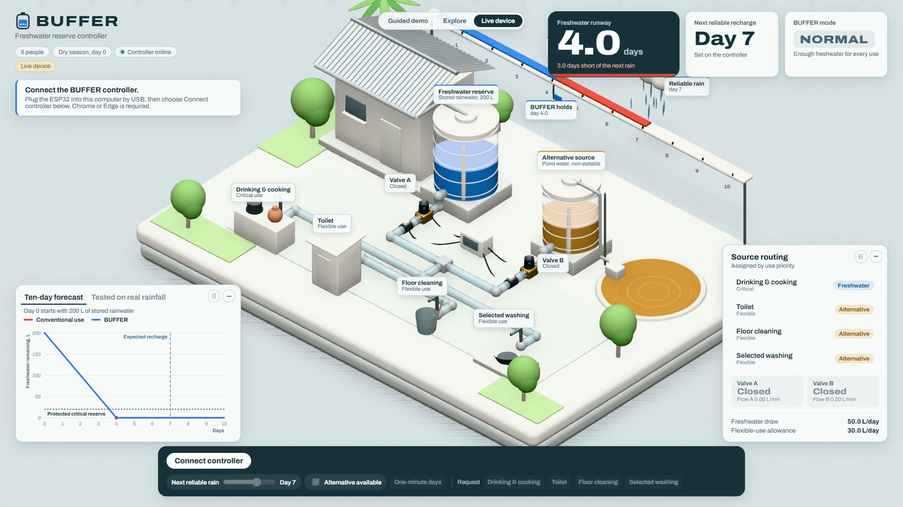
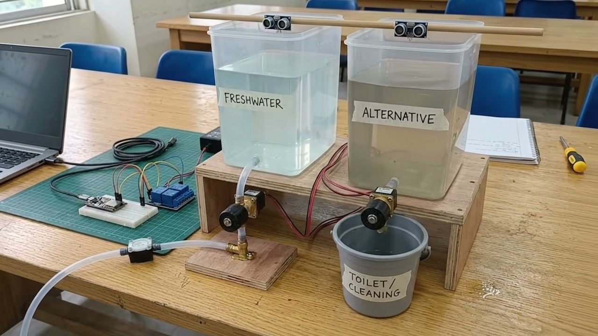
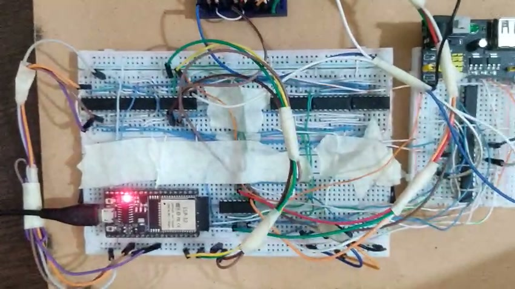

<div align="center">

# BUFFER

### Protect the water you cannot replace.

**Adaptive freshwater reserve management for climate-vulnerable households**

Xylem Global Student Innovation Challenge 2026 · University track · Water Access

[](https://ashfaqstu.github.io/BUFFER/)
[](#the-problem)
[](LICENSE)


</div>

---

## The problem

On the southwest coast of Bangladesh (Khulna, Satkhira, Bagerhat) the sea pushes salt into rivers, ponds and
groundwater. **Rain is the only water safe to drink.** Families store the monsoon in one tank, and it has to last
five dry months, but cooking, cleaning and the toilet all draw from the same tank. In Koyra, every household drinks
rainwater during the monsoon; only **27% still have it all year**
([Cleaner Water, 2025](https://doi.org/10.1016/j.clwat.2025.100171)).

Tanks, level monitors and automatic pump switches already exist. A tank only stores, a monitor only warns, and a
pump switch acts after the tank is empty and assumes a mains supply these villages do not have.

## What BUFFER does

BUFFER treats stored rainwater like a battery. A small controller on the household tank:

1. **measures** how much freshwater is left,
2. **works out how many days of drinking water that is** and compares it with the next reliable rain,
3. **routes flexible uses** (toilet, floor cleaning, selected washing) to a pre-qualified alternative source such as
   the pond **before** the protected drinking reserve is at risk,
4. **tightens the reserve** if the rain comes late.

Drinking and cooking always get freshwater. The household can always override it.



## Results

Tested on **34 real dry seasons of rainfall from Koyra** (NASA POWER, 1991-2025) for a 5-person household with a
3,000 L tank. Results are simulated on real rainfall; household values are assumptions until a field pilot measures them
([research/assumptions.md](research/assumptions.md)).

| | Without BUFFER | With BUFFER |
|---|:---:|:---:|
| Days without enough drinking water, per season | **70.5** | **0.5** |
| Seasons with any shortage | 34 of 34 | 3 of 34 |
| Chance of a shortage (2,000 resampled seasons, noisy demand) | 99.9% | 8.2% |

- Same protection as always using the alternative source, with **54% less** alternative water.
- Holds at five Bangladeshi coastal sites (59-71 → 0-0.5 shortage days).
- Run the way households behave today, the model reproduces four of five published field figures from Khulna.
- BUFFER cannot create water: very small tanks (1,000-2,000 L) still fall short.

<p align="center">
  
  <br>
  
</p>

Full method and every experiment: [simulation/results/REPORT.md](simulation/results/REPORT.md) · impact write-up: [docs/IMPACT.md](docs/IMPACT.md)

## The simulator

**[Open the live simulator →](https://ashfaqstu.github.io/BUFFER/)** A 3D digital twin of a BUFFER household that
runs the same planning and routing rules as the controller firmware.

| Guided demo: conventional use runs dry on day 4 | Guided demo: BUFFER reroutes and holds to day 7 |
|---|---|
|  |  |
| **Explore: run the model on your own household** | **Live device: mirror the real controller over USB** |
|  |  |

- **Guided demo:** a 45-second story. Conventional use runs dry on day 4.0; BUFFER switches to Preserve and holds to
  day 7.0, then to day 9.0 when the rain is delayed.
- **Explore:** set people, stored litres, demand, protected reserve, next reliable rain, alternative source, household
  override and advice-only mode, and watch the plan change.
- **Live device:** connects to the ESP32 over Web Serial (Chrome or Edge) and mirrors its tanks, valves and decisions.

## The hardware

A working bench prototype: two tanks, two valves and an ESP32 running the BUFFER firmware on its own, with no laptop
or internet needed.

| Bench prototype | Controller |
|---|---|
|  |  |

| Part | Role |
|---|---|
| ESP32 DevKit V1 | Sensing, planning, valve control, USB telemetry |
| 2 × HC-SR04 ultrasonic sensors | Level in each tank (median filter, fault latch) |
| 2 × 12 V normally-closed solenoid valves + relay module | Valve A (freshwater), valve B (alternative); closed without power |
| YF-S201 flow sensor | Metered dose and actual freshwater use |
| 12 V adapter + LM2596 buck converter | Power for valves and electronics |

Bench prototype: **about 5,800 BDT (≈ US$48)**, priced part by part in [hardware/bom.csv](hardware/bom.csv).
Household version: about 6,300 BDT, designed to fit the tanks non-profit organizations already install
([hardware/installation.md](hardware/installation.md)). On a level-sensor fault the controller keeps drinking water
flowing and protects the reserve; if power fails both valves close and a manual tap stays usable.

## Built with

| Part | Technology |
|---|---|
| Simulation | Python 3.12, NumPy, pandas, Matplotlib, pytest; NASA POWER daily rainfall (PRECTOTCORR) |
| Firmware | C++ on the Arduino framework for ESP32, PlatformIO, Unity tests |
| Simulator | React 19, TypeScript, Vite, three.js with React Three Fiber, drei and postprocessing, Web Serial API |
| Quality | pytest and Unity test suites, GitHub Actions workflows (tests, firmware build, simulator deploy), oxlint, Playwright browser checks |

## Repository

```
BUFFER/
├── simulation/   daily water-balance model, 5 policies, sweeps, Monte Carlo, results and figures
├── firmware/     ESP32 controller: sensing, planning, routing, fail-safes, telemetry, unit tests
├── dashboard/    3D simulator: guided demo, Explore, Live device (deployed to GitHub Pages)
├── hardware/     bill of materials, wiring and pin map, serial protocol, household installation
├── validation/   bench test protocol with pass criteria
├── research/     bibliography, prior art, patent search, assumptions register, media sources
├── docs/         impact, failure modes, deployment and business model, pilot plan
└── PROJECT.md    full project brief: problem, research basis, design decisions
```

## Run it yourself

```bash
# simulation (Python 3.12)
cd simulation
pip install -r requirements.txt
python -m pytest                                          # 10 tests
python -m buffer_sim.experiments && python -m buffer_sim.report

# simulator (Node.js 20.19+ or 22.12+)
cd dashboard
npm install
npm run dev                                               # http://localhost:5173

# firmware (PlatformIO)
cd firmware
pio test -e native                                        # 12 controller logic tests
pio run -e esp32dev -t upload                             # flash the ESP32
```

## Status

| | |
|---|---|
| **Built and working** | Simulation on real rainfall · ESP32 firmware · 3D simulator · bench prototype |
| **Simulated, not measured** | Every household result: demand, tank size and roof area are assumptions ([research/assumptions.md](research/assumptions.md)) |
| **Next** | Formal bench test runs ([validation/experiments.md](validation/experiments.md)) · stakeholder conversations ([research/stakeholder-notes.md](research/stakeholder-notes.md)) · a 20-household dry-season pilot ([docs/PILOT_PLAN.md](docs/PILOT_PLAN.md)) |

## Acknowledgements

Rainfall data: [NASA POWER](https://power.larc.nasa.gov/). Field figures for Koyra and Khulna are cited in
[research/bibliography.md](research/bibliography.md). Claude (Anthropic) assisted with parts of the code, the
documentation and the submission video; the team reviewed all of it, and every number traces to a file in this repository.

## License

[MIT](LICENSE)
